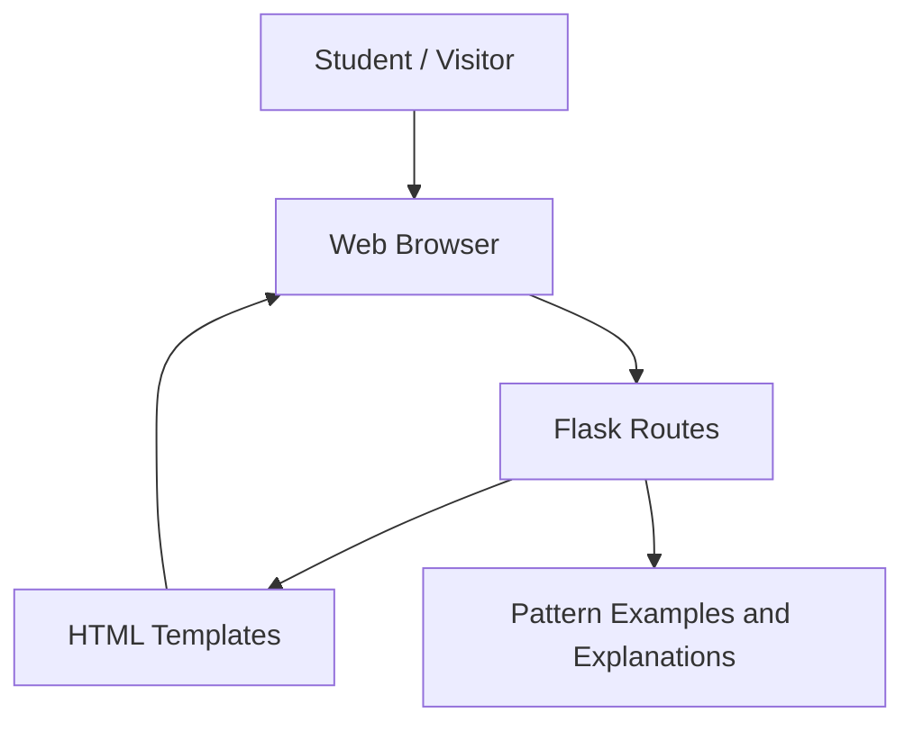
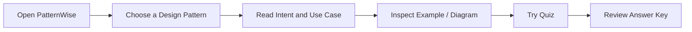
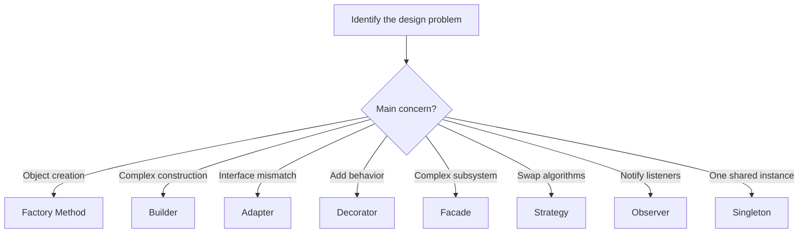

# PatternWise — Diagrams

The following Mermaid diagrams can be pasted into a Mermaid-compatible editor or Markdown viewer.

## High-level architecture

## Learning flow

## Pattern-selection guide

